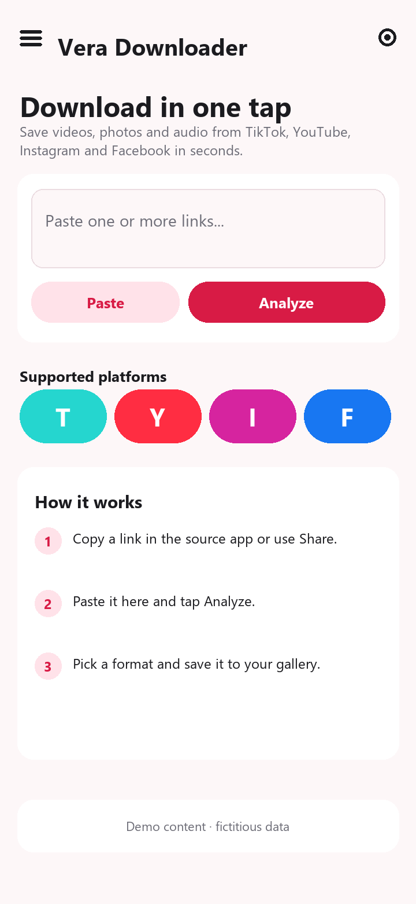
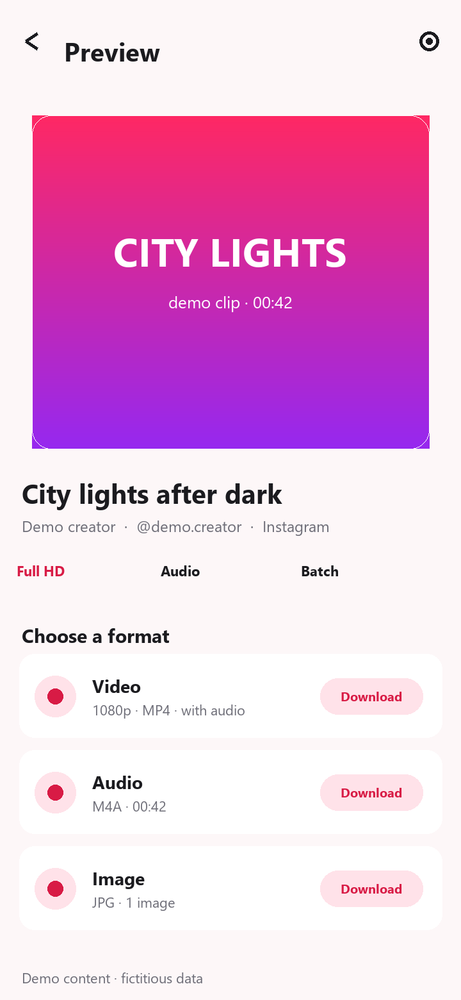
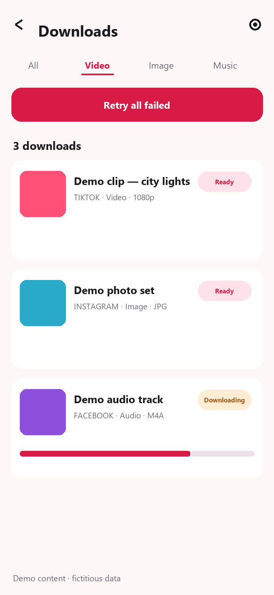
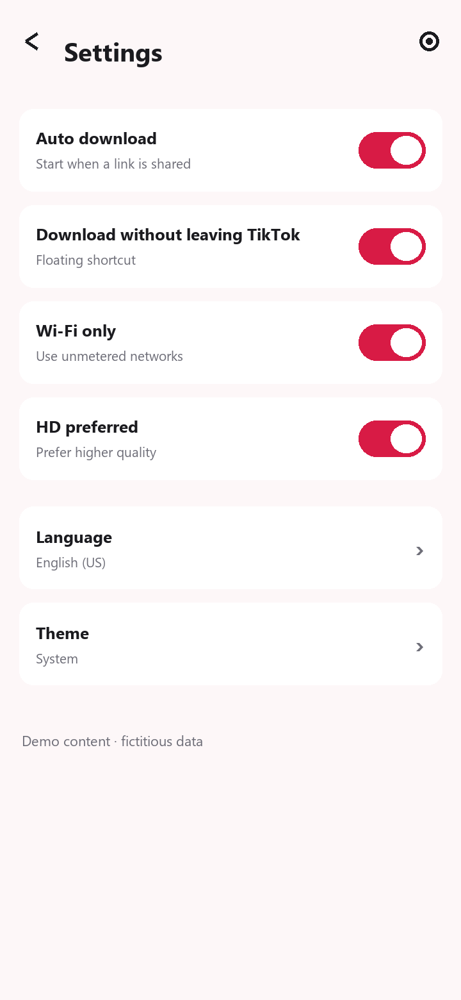
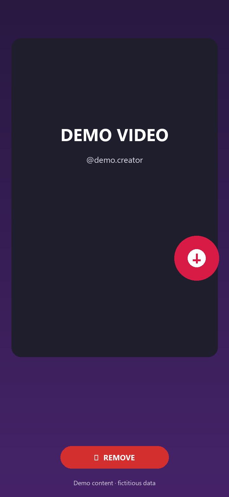

# Vera Downloader

Vera Downloader is a native Android app for saving **videos, photos, and audio** from
**TikTok, YouTube, Instagram, and Facebook**. Paste a link or share it from another app,
preview the media, and download it to your gallery.

Built with **Kotlin + Jetpack Compose**. Parsing and downloads happen on the device; there is
no backend, no ads, and no analytics.

> **Use responsibly.** Download only content you own or have permission to save. Platform
> terms and copyright rules still apply. TikTok, YouTube, Instagram, and Facebook are
> trademarks of their respective owners. This project is not affiliated with them.

## Features

- Receive links via Android **Share** (`ACTION_SEND`) and **Open with** (`ACTION_VIEW`).
- Paste one or more links on the home screen.
- Preview cover, title, author, duration, and formats before downloading.
- Download **video**, **audio only**, or **images**.
- Multi-image carousels: select thumbnails, select all, confirm, then download.
- TikTok photo posts: **Video Slideshow** generated locally, plus audio and images.
- Download queue with **WorkManager**, progress notifications, and MediaStore output:
  - videos: `Movies/Vera Downloader`
  - images: `Pictures/Vera Downloader`
  - audio: `Music/Vera Downloader`
- **Idempotent downloads**: the same source + media type + quality is not downloaded twice.
  Completed items say “This item has already been downloaded”; queued items are not
  duplicated; failed items reuse the existing record when retried.
- **Real cancellation**: deleting a running item cancels its WorkManager job. The
  notification has a **Cancel** action and a dismiss intent. The worker checks `isStopped`
  while streaming.
- **Resumable transfers**: HTTP `Range` chunks plus retry from the last received byte.
- Local history with filters (all/video/image/music), retry, open, share, delete, wallpaper,
  and ringtone actions.
- **30 languages** in `app/src/main/assets/i18n`, with RTL for Arabic, Hebrew, Persian, and
  Urdu. Light, dark, and system themes.
- **Floating TikTok shortcut** (“Download without leaving TikTok”): copy a TikTok link, tap
  the bubble, confirm. Drag the bubble to the **✕ REMOVE** bar to disable it. The bubble
  accepts only TikTok links from the clipboard.
- **Feedback** form opens the user's email app with a pre-filled message.
- **Play In-App Update** support when installed from Google Play.

### Supported platforms

| Platform | Video | Audio | Images | Notes |
|---|---|---|---|---|
| TikTok | Yes | Yes | Yes | Public `tikwm` API. Photo posts get a generated slideshow. |
| YouTube | Yes | Yes | — | InnerTube `VISIONOS` client with fallbacks; DASH tracks muxed locally. |
| Instagram | Yes | Yes | Yes | Public embed/oEmbed. Login-gated posts show a preview only. |
| Facebook | Yes | Yes | Yes | Mobile Open Graph page; video plugin fallback. |

Public posts are required. Private, age-restricted, region-restricted, or login-gated content
may return only a preview or an explanatory error.

## Screenshots

Fictitious UI mockups with demo content. No real accounts, links, or media are shown.

| Home | Preview |
|---|---|
|  |  |

| History | Settings |
|---|---|
|  |  |

| Floating shortcut and remove bar |
|---|
|  |

## Requirements

**To run**

- Android 8.0 (API 26) or newer
- Internet connection
- Notification permission on Android 13+
- Overlay permission only for the floating TikTok shortcut

**To build**

- JDK 17
- Android SDK `platforms;android-35` and `build-tools;36.0.0`
- Gradle 8.11.1 (wrapper included)
- Kotlin 2.0.21, Android Gradle Plugin 8.7.3

## Build

### Windows

```powershell
$env:JAVA_HOME = "C:\Program Files\Microsoft\jdk-17.0.21.21-hotspot"
.\gradlew.bat :app:assembleDebug --no-daemon
```

### macOS / Linux

```bash
export JAVA_HOME=/path/to/jdk-17
./gradlew :app:assembleDebug --no-daemon
```

The APK is written to `app/build/outputs/apk/debug/app-debug.apk`.

For a release build, configure your own signing key and run:

```bash
./gradlew :app:assembleRelease
```

Do not commit `local.properties`, keystores, or signing passwords.

## Install

### Install from a GitHub Release

A signed, installable APK is published on GitHub Releases:

**https://github.com/JohnSalazar/vera-downloader/releases/latest**

Direct asset:

**https://github.com/JohnSalazar/vera-downloader/releases/download/v1.0.0/vera-downloader-v1.0.0.apk**

Release details:

| Item | Value |
|---|---|
| Version | `1.0.0` |
| File | `vera-downloader-v1.0.0.apk` |
| Size | 12,285,101 bytes |
| SHA-256 | `9A6C1890F4CCB9B0A9EBBDC63029114570279A763325514B08673A9A8DA48050` |
| Minimum Android | 8.0 (API 26) |
| Signing certificate SHA-256 | `71:A0:55:BC:BE:2C:8A:77:B4:BC:84:3C:04:5B:7C:59:F3:93:62:69:C0:94:EB:57:34:E5:B2:0C:21:06:5E:93` |

#### Install on the phone

1. Open the release link on the Android phone.
2. Download `vera-downloader-v1.0.0.apk`.
3. Open the downloaded file from **Files → Downloads**.
4. If Android blocks it, allow **Install unknown apps** for the browser or file manager.
5. Tap **Install**.
6. If Play Protect shows a warning because the app was not installed from Play, choose
   **Install anyway**. The APK is signed, but it is not distributed through Google Play.
7. Open **Vera Downloader** and grant notification permission.

The app has no account or login. It works immediately after installation.

#### Verify the download (optional)

On a computer with `sha256sum`:

```bash
sha256sum vera-downloader-v1.0.0.apk
```

The output must be:

```
9a6c1890f4ccb9b0a9ebbdc63029114570279a763325514b08673a9a8da48050
```

#### Install with ADB

```bash
adb install -r vera-downloader-v1.0.0.apk
adb shell am start -n com.vera.downloader/.MainActivity
```

If an older debug build is installed with a different signing key, uninstall it first:

```bash
adb uninstall com.vera.downloader
adb install vera-downloader-v1.0.0.apk
```

Uninstalling removes local history and settings but not files already saved in the gallery.

#### Updating a GitHub release install

Download and install a newer APK over the existing app. Future releases must be signed with
the same key; otherwise Android requires an uninstall first. The in-app **Check for updates**
action uses Google Play and only works for a Play Store installation.

### Install a local build with ADB

## How to use

### Paste a link

1. Copy a post link from TikTok, YouTube, Instagram, or Facebook.
2. Open Vera Downloader.
3. Tap **Paste**, then **Analyze**.

**Analyze** always opens the preview. Automatic download only happens for links received
through Android Share, and only if **Auto download** is enabled.

### Share from another app

1. Open a post and tap **Share**.
2. Choose **Vera Downloader**.
3. Choose a format in the preview and tap **Download**.

The share flow is the most reliable because the app receives the canonical post URL.

### Choose a format

- **Video** — MP4, best available resolution within the downloader's size guard.
- **Audio** — M4A/MP3, downloaded or extracted from the video depending on the platform.
- **Image** — JPG/WebP for photo posts and carousels.
- **Slideshow** — TikTok photo posts: locally generated MP4 with the images and audio.

For a multi-image post:

1. Tap the image thumbnails to select them.
2. Use **Select all** if wanted.
3. Tap **Download selected**.
4. Confirm in the dialog.

### History and downloads

- Progress appears in the notification shade and in **History**.
- Cancel a running download by deleting it in History or using **Cancel** in the notification.
- Completed items can be opened, shared, or deleted.
- Tapping an image thumbnail opens the image; a video/audio thumbnail plays it.
- **Retry all** appears when there are failed downloads.
- Deleting a completed item also removes its MediaStore entry.

### Settings

| Setting | Description |
|---|---|
| Auto download | Download the first suitable item when a link is shared into the app. |
| Download without leaving TikTok | Enables the floating bubble and overlay permission. |
| Wi-Fi only | Restricts downloads to unmetered networks. |
| HD preferred | Prefers higher-quality video when available. |
| Language | 30 languages, applied instantly. |
| Theme | Light, dark, or system. |
| Check for updates | Google Play In-App Update; sideloaded builds open the Play Store listing. |
| About | Version and project information. |

### Floating TikTok shortcut

1. Enable **Settings → Download without leaving TikTok**.
2. Grant **Display over other apps**.
3. Open TikTok, copy a post link, then tap the floating bubble.
4. Confirm the link and tap **Download**.
5. To disable it, drag the bubble to **✕ REMOVE** at the bottom and drop it on the bar.

Android does not allow one app to read another app's internal URL. The bubble uses the
clipboard: first use TikTok's **Share → Copy link**.

### Feedback

Open the side menu → **Send feedback**, choose a type, write a message, and tap send. The
user's email app opens with the message pre-filled. Vera does not send the message itself.

## Project structure

```
app/src/main/java/com/vera/downloader/
├── VeraApp.kt                 Application, graph, notification channel
├── MainActivity.kt            Single Activity; handles SEND/VIEW intents
├── MainViewModel.kt           UI state, parsing, download actions
├── core/Core.kt               Models, LinkDetector, HtmlUtil, HTTP client
├── parser/Parsers.kt          TikTok, YouTube, Instagram, Facebook, ParserChain
├── data/Data.kt               Records, SQLite, repository, settings, Graph
├── download/
│   ├── Download.kt            Queue + DownloadWorker
│   ├── Mp4Remuxer.kt          Mux video/audio without re-encoding
│   ├── SlideshowBuilder.kt    TikTok photo-to-video generator
│   ├── AudioExtractor.kt      Audio extraction from MP4
│   ├── AudioTranscoder.kt     MP3 → AAC conversion
│   └── CancelDownloadReceiver.kt
├── overlay/                   Bubble service, translucent download Activity
├── i18n/I18n.kt               Translation engine and RTL
└── ui/                        Home, preview, history, settings, help, feedback
```

### Data flow

```
Share / Paste
     │
     ▼
LinkDetector → ParserChain → ParseResult
                                  │
                 ┌────────────────┴────────────────┐
                 ▼                                 ▼
          Preview UI                    Downloads.enqueue
                                                   │
                                         WorkManager worker
                                                   │
                                   OkHttp → temp file → MediaStore
                                                   │
                                      SQLite history + notification
```

### Platform parsers

| Platform | Provider | Approach |
|---|---|---|
| TikTok | `tikwm` | Public API returns `play`, `hdplay`, `music`, `images`, cover, author. |
| YouTube | `youtube-visionos` | InnerTube player with `VISIONOS` + `visitorData`; fallbacks: `IOS`, `ANDROID_VR`, `WEB`. |
| Instagram | `instagram-embed` / `instagram-oembed` | Mobile embed HTML with escaped JSON decoding; public oEmbed fallback. |
| Facebook | `facebook-mobile-og` / `facebook-plugin` | Mobile Open Graph page; `plugins/video.php` fallback. |

## How downloads work

1. `Downloads.enqueue` builds an idempotency key from **source URL + media kind + quality**.
2. Completed record → report already downloaded; no duplicate file or record.
3. Queued/running record → do not queue again.
4. Failed record → reset and reuse the same record.
5. `DownloadWorker` transfers with OkHttp.
6. Large or restricted streams use HTTP `Range` chunks and resume from the last byte.
7. Separate video/audio tracks are muxed with `MediaMuxer`.
8. The final file is inserted into MediaStore and the record is marked complete.

**Networking defaults**

- Total request timeout: **10 minutes**
- Read timeout: **60 seconds**
- Range chunk: **4 MB**
- Up to **4 attempts** with backoff

### Cancellation

- Deleting a running item calls `WorkManager.cancelUniqueWork`.
- The worker checks `isStopped` while streaming.
- The notification has a **Cancel** action and a dismiss intent handled by
  `CancelDownloadReceiver`.
- Cancelled work does not show a failure notification.

## Permissions and privacy

| Permission | Why |
|---|---|
| `INTERNET` | Parse pages/APIs and download media. |
| `POST_NOTIFICATIONS` | Download progress notifications on Android 13+. |
| `SYSTEM_ALERT_WINDOW` | Optional floating TikTok shortcut. |
| `FOREGROUND_SERVICE`, `FOREGROUND_SERVICE_DATA_SYNC` | Keep downloads and the overlay alive. |
| `WAKE_LOCK` | Allow WorkManager to finish long downloads. |

Vera Downloader has no analytics, ads, or tracking SDKs. It does not upload downloaded files
to a server. History and settings are stored locally (`vera.db` and SharedPreferences).
Feedback is sent only through the user's email app. The project does not include the original
analyzed app's code, assets, models, or audio.

The YouTube parser contains YouTube's **public InnerTube web client key**. It is a public
client identifier used by the web player, not a private credential or user secret. No private
API keys, signing keys, access tokens, or passwords are committed.

Clearing app data removes local history and settings. Downloaded files remain in the gallery
until deleted.

## Troubleshooting

### “No app can open this file”

The file is probably audio with a video extension. Delete it and download again. Current
builds save extracted audio as `.m4a` with the correct MIME type.

### Instagram or Facebook shows “Open in …”

The post is private, login-gated, or the public page did not expose media. Public Instagram
embeds/Reels, Facebook images, and Facebook videos are supported; login-only content is not.

### YouTube returns HTTP 403

Some videos are age/region restricted or require a PO token. Try another format, retry later,
or open the video in a browser. The app uses multiple InnerTube clients but cannot bypass
authentication restrictions.

### YouTube downloads are slow

YouTube usually provides separate DASH video and audio tracks. Vera downloads both and muxes
them locally, which is slower than a single-file platform download. Large videos can take
several minutes.

### The bubble cannot read the link

Android prevents reading another app's internal URL. Copy the link in TikTok first
(**Share → Copy link**), then tap the bubble. The bubble ignores non-TikTok clipboard text.

### Notification reappears after swiping

Use the **Cancel** action. Deleting the item in History also cancels its WorkManager job. The
notification is a foreground-service notification, so the system may keep it while a transfer
is active.

### In-app update does not start

In-App Updates require an installation from Google Play and a newer published version. A
sideloaded debug APK opens the Play Store listing instead.

### Build fails with “SDK location not found”

Create `local.properties`:

```properties
sdk.dir=C\:\\Users\\you\\AppData\\Local\\Android\\Sdk
```

`local.properties` is intentionally ignored by Git.

## Known limitations

- Only public content can be downloaded reliably.
- No AI watermark removal. A no-watermark source is used when the platform provides one.
- No ads, subscriptions, billing, or account system.
- Instagram and Facebook change their HTML frequently; parser updates may be required.
- YouTube may still return 403 or require login for restricted videos.
- The app does not bypass DRM or private-content restrictions.
- The debug APK is not signed for store distribution.
- Generated TikTok slideshows are best-effort; long posts can take several minutes.
- The layout is phone-first; tablets work but are not specifically optimized.

## Testing

Validated on a Samsung Galaxy S26 Ultra (Android 16) and an Android 15 emulator.

| Scenario | Result |
|---|---|
| `assembleDebug` | Build succeeds |
| Share a TikTok link | Preview with cover, title, author, formats |
| TikTok video | Saved to `Movies/Vera Downloader` |
| YouTube video | DASH/muxed preview and download |
| YouTube Shorts | Video + audio tracks |
| YouTube audio | M4A in `Music/Vera Downloader` |
| Instagram public Reel | MP4 + M4A + image |
| Facebook share links | Image, video, and audio |
| Multi-image carousel | Thumbnails, multi-select, confirmation |
| TikTok photo post | Generated MP4 + M4A + images |
| Idempotency | Second tap does not duplicate a completed item |
| Cancellation | Delete/notification cancel stops WorkManager |
| Dark theme switches | High-contrast thumb/track |
| 30 languages | Instant switching, including RTL |

Reproduce a share flow:

```bash
adb shell am start -a android.intent.action.SEND -t text/plain \
  --es android.intent.extra.TEXT "https://www.tiktok.com/@scout2015/video/6718335390845095173" \
  -n com.vera.downloader/.MainActivity
```

Check MediaStore:

```bash
adb shell content query --uri content://media/external/video/media \
  --projection _display_name:relative_path:_size:duration:width:height
```

## Third-party notices

- Jetpack Compose, Material 3, WorkManager, OkHttp, Coil, and Kotlin coroutines are used
  under their respective Apache 2.0 / BSD-style licenses.
- Platform icons are based on **Simple Icons** (CC0 1.0). TikTok, YouTube, Instagram, and
  Facebook logos are trademarks of their owners and are used only to identify supported
  platforms.
- Vera Downloader is an independent project, not endorsed by or affiliated with any platform.

## Support

For questions, bug reports, feature requests, or security concerns, contact:

**support@veradownloader.com**

Please include the Android version, device model, the source link (if public), and the exact
error message shown in the app.

## License

MIT License. See [LICENSE](LICENSE).

Copyright (c) 2026 John Salazar.
